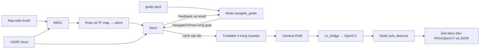

# Bài thực hành tiếp theo – Navigation bằng code và nhận diện YOLO

Ubuntu 24.04, ROS 2 Jazzy, Gazebo Harmonic. Dùng package `turtlebot4_slam_nav`
và bản đồ đã quét ở bài trước: `maps/depot_02.yaml` + `maps/depot_02.pgm`.
Tên file bản đồ không bắt buộc là `map.yaml`; YAML phải trỏ đúng file PGM.
Không chạy SLAM trong bài này.


 
| Terminal | Công việc |
|---|---|
| A | Gazebo + map server + AMCL + Nav2 + RViz |
| B | Ghi goal, rồi chạy node điều hướng tuần tự |
| C | Camera YOLO, giữ mở suốt demo |
| D | Kiểm tra topic/action, undock trước hành trình |

Trong **mỗi terminal**, bắt đầu bằng:

```bash
source ~/tb4_ws/src/turtlebot4_slam_nav/scripts/env.sh
cd ~/tb4_ws
```

## 0. Build và chuẩn bị YOLO

Build sau khi cập nhật source:

```bash
/usr/bin/python3 -m colcon build --symlink-install --packages-select turtlebot4_slam_nav
source install/local_setup.bash
ros2 pkg executables turtlebot4_slam_nav
```

Cần thấy `goal_recorder`, `navigate_goals`, `yolo_detector` và `save_map.sh`.
Nếu thiếu thư viện ROS, cài bằng apt rồi source môi trường lại:

```bash
sudo apt install ros-jazzy-cv-bridge python3-opencv python3-venv python3-pip
```

Chuẩn bị YOLO một lần; cần Internet để tải thư viện và weights:

```bash
bash src/turtlebot4_slam_nav/scripts/setup_yolo.sh
```

Script tạo `.venv-yolo` bằng Python 3.12 hệ thống với `--system-site-packages`,
cài Ultralytics cùng các thư viện dùng cho node inference và PyTorch CPU,
dùng OpenCV có sẵn từ apt cùng `cv_bridge`,
giữ NumPy 1.26.4 tương thích `cv_bridge`, tải
`models/yolo11n.pt` và chạy một lượt inference kiểm tra. Không cài pip vào
Python hệ thống. YOLO dùng weights local khi demo, không tự tải trong callback.
Ảnh đen của bước cài đặt chỉ kiểm tra inference, không chứng minh nhận diện vật thể.

Node YOLO phải chạy bằng **`.venv-yolo/bin/python -m ...`** như mục 4:
`ros2 run` dùng shebang Python hệ thống nên không tự dùng thư viện trong venv.
Không source venv trước `env.sh` vì script ROS sẽ đặt lại PATH.

## 1. Khởi chạy đúng world, load map và localization

**A:** dừng toàn bộ launch cũ bằng Ctrl+C trước khi chạy:

```bash
ros2 launch turtlebot4_slam_nav navigation.launch.py \
  world:=depot gui_render_engine:=ogre2 \
  map:="$HOME/tb4_ws/src/turtlebot4_slam_nav/maps/depot_02.yaml"
```

Launch này bật cả AMCL **và Nav2**. `localization.launch.py` của bài trước
chỉ bật AMCL nên chưa đủ để chạy node điều hướng. Giữ Gazebo ở **Play**.
Nếu GUI crash, dừng A và thêm `gazebo_gui:=false` để chạy server + RViz.

**D — kiểm tra map, clock, scan và các lifecycle node; Ctrl+C với lệnh liên tục:**

```bash
ros2 topic echo /clock rosgraph_msgs/msg/Clock --once
ros2 topic echo /map nav_msgs/msg/OccupancyGrid --once --field info \
  --qos-durability transient_local
ros2 topic echo /scan sensor_msgs/msg/LaserScan --once --field header \
  --qos-reliability best_effort
ros2 lifecycle get /amcl
ros2 lifecycle get /bt_navigator
ros2 action list -t
```

Trong RViz: **Fixed Frame = map**, bật Map, RobotModel, LaserScan, AMCL particles.
Với `depot_02.yaml` và vị trí spawn mặc định, AMCL tự nhận initial pose
`(x=0, y=0, yaw=0)` trong hệ map. Không cần chọn **2D Pose Estimate** mỗi lần.
Kiểm tra điểm LiDAR trùng tường trên bản đồ trước khi tiếp tục.
Nếu dùng bản đồ khác hoặc đổi vị trí spawn, chế độ `auto_initial_pose:=auto`
không tự áp dụng pose này. Có thể chọn **2D Pose Estimate** thủ công, hoặc
truyền `auto_initial_pose:=true initial_pose_x:=... initial_pose_y:=...
initial_pose_yaw:=...` với tọa độ map đã kiểm chứng. Dùng
`auto_initial_pose:=false` để luôn khởi tạo bằng tay.
Không lấy tọa độ spawn Gazebo làm initial pose nếu hệ `map` của lần quét có
gốc/hướng khác; đối chiếu hình học tường và vị trí robot.

```bash
ros2 topic echo /amcl_pose geometry_msgs/msg/PoseWithCovarianceStamped \
  --once --qos-durability transient_local
ros2 run tf2_ros tf2_echo map base_link --ros-args -p use_sim_time:=true
```

Node điều hướng chờ AMCL và `bt_navigator` active, `/amcl_pose`, `/clock` và
TF `map -> base_link` còn mới. Nó không tự đặt lại vị trí ban đầu của robot.
Kiểm tra LiDAR khớp tường bằng mắt vẫn cần thực hiện; có TF chưa chứng minh
localization đúng.

**D — undock trước khi bắt đầu hành trình nếu robot đang dock:**

```bash
ros2 topic echo /dock_status irobot_create_msgs/msg/DockStatus --once
ros2 action send_goal /undock irobot_create_msgs/action/Undock '{}' --feedback
```

Chỉ gửi action undock nếu `is_docked: true`; chờ SUCCEEDED và kiểm tra false.

## 2. Ghi ít nhất 3 tọa độ goal

### Cách 1: Publish Point, không điều khiển robot

**B:**

```bash
ros2 run turtlebot4_slam_nav goal_recorder --ros-args \
  -p use_sim_time:=true \
  -p output_file:="$HOME/tb4_ws/src/turtlebot4_slam_nav/config/goals.yaml" \
  -p yaw:=0.0
```

Trong RViz, chọn **Publish Point**, click lần lượt ít nhất 3 điểm tại các khu
vực khác nhau. Có thể cần chọn lại công cụ sau mỗi click. Chọn điểm trong vùng
trống, cách tường/vật cản một khoảng đủ cho robot và costmap inflation; tránh
vùng chưa biết. Mỗi click lưu ngay một goal vào YAML và in tọa độ ra terminal.
Recorder nối tiếp vào file có sẵn, từ chối điểm cách điểm đã ghi dưới 0.1 m.

`Publish Point` chỉ có **x, y**, không có hướng. Recorder dùng `yaw` radian
(mặc định 0). Có thể đổi hướng cho click tiếp theo trong D:

```bash
ros2 param set /goal_recorder yaw 1.57079632679
```

Hướng theo hệ map: 0 hướng +x, π/2 hướng +y, π hướng −x, −π/2 hướng −y.
Hướng nhìn camera nên quay về vật thể định quan sát. Không suy ra yaw từ
hướng màn hình RViz nếu view đã xoay.

Ghi xong, Ctrl+C ở B rồi xem/chỉnh file:

```bash
cat src/turtlebot4_slam_nav/config/goals.yaml
nano src/turtlebot4_slam_nav/config/goals.yaml
```

Cấu trúc mỗi mục là `name`, `x`, `y`, `yaw`; đơn vị m, m, rad. File ban đầu
chứa `goals: []` để bạn ghi tọa độ thật. Không dùng tọa độ mẫu của world khác.
Để ghi bộ mới mà vẫn giữ bộ cũ, truyền `output_file` sang một tên khác và dùng
đúng file đó khi chạy navigation. Đóng recorder trước khi sửa YAML bằng tay.

### Cách 2: Lưu vị trí và hướng hiện tại từ AMCL

Nếu khảo sát bằng robot trước khi chạy chương trình, giữ recorder mở và gọi:

```bash
ros2 service call /record_current_pose std_srvs/srv/Trigger '{}'
```

Mỗi lần gọi lưu x, y và yaw tính từ quaternion AMCL. Chỉ gọi khi pose AMCL
phản ánh vị trí đã tới; AMCL không nhất thiết publish lại khi robot đứng yên.
Việc khảo sát/teleop phải hoàn tất **trước** khi bắt đầu hành trình tự động.

Lập bảng Goal 1/2/3 với x, y, yaw đã ghi để đưa vào báo cáo/video.

## 3. Chạy node tự động Goal 1 → Goal 2 → Goal 3

Đóng teleop và recorder. Chạy YOLO ở C theo mục 4 trước để quay được toàn hành trình.
**B:**

```bash
ros2 run turtlebot4_slam_nav navigate_goals --ros-args \
  -p use_sim_time:=true \
  -p goals_file:="$HOME/tb4_ws/src/turtlebot4_slam_nav/config/goals.yaml" \
  -p results_file:="$HOME/tb4_ws/log/navigation_results.json"
```

Chương trình gửi action `/navigate_to_pose`, chờ từng goal. Chỉ sau kết quả
`SUCCEEDED` mới gửi goal tiếp theo. Dừng nếu goal bị từ chối, aborted, canceled
hoặc timeout. Không tự bỏ qua goal lỗi để báo hoàn thành giả.

Mặc định chờ sẵn sàng tối đa 180 giây thực; mỗi goal tối đa 300 giây mô phỏng
và 1800 giây thực. Nghỉ 3 giây thực tại mỗi goal để quan sát camera. Máy mô
phỏng chậm có thể tăng bằng tham số `ready_timeout`, `goal_timeout`,
`wall_timeout`, `pause_at_goal` (kiểu số thực, ví dụ `600.0`). Không tăng tốc
robot bằng teleop trong hành trình; vận tốc do controller Nav2 quyết định.

Sau khi node bắt đầu, **không teleop, không dùng Nav2 Goal trên RViz và không
đặt lại initial pose**. Dùng RViz chỉ để quan sát map, path, costmap và camera.
Ctrl+C tại B yêu cầu hủy action hiện tại trước khi thoát. Nếu log báo chưa xác
nhận hủy do mất liên lạc, kiểm tra robot và dừng launch A trước khi chạy lại.

**D — theo dõi kết quả:**

```bash
ros2 topic echo /navigate_to_pose/_action/status action_msgs/msg/GoalStatusArray
```

`status: 4` là SUCCEEDED, 5 CANCELED, 6 ABORTED. Kết thúc rồi xem file:

```bash
cat log/navigation_results.json
```

File ghi tọa độ, goal UUID, status, thời gian mô phỏng/thực và error code của
từng goal. Muốn giữ nhiều lần chạy, đổi `results_file`; mặc định lần chạy sau
ghi lại file cũ. Chỉ kết luận hoàn thành khi trạng thái chung SUCCEEDED và
ít nhất 3 goal đều SUCCEEDED. Video phải cho thấy robot không va chạm;
status thành công riêng lẻ không thay thế bằng chứng đó.

## 4. Camera RGB và YOLO chạy song song

**D — kiểm tra đúng topic ảnh trên robot standard:**

```bash
ros2 topic list --no-daemon --spin-time 5
ros2 topic info /oakd/rgb/preview/image_raw -v
ros2 topic echo /oakd/rgb/preview/image_raw sensor_msgs/msg/Image \
  --once --field header --qos-reliability best_effort
ros2 topic hz /oakd/rgb/preview/image_raw
```

Bridge Jazzy đang remap camera Gazebo sang `/oakd/rgb/preview/image_raw`.
Nếu dùng namespace khác, kiểm tra topic list và đổi `image_topic` bên dưới.
Ctrl+C lệnh hz trước khi chạy lệnh khác.

**C — YOLO với cửa sổ OpenCV:**

```bash
export YOLO_CONFIG_DIR="$HOME/tb4_ws/log/ultralytics"
./.venv-yolo/bin/python -m turtlebot4_slam_nav.yolo_detector --ros-args \
  -p use_sim_time:=true \
  -p model_path:="$HOME/tb4_ws/models/yolo11n.pt" \
  -p image_topic:=/oakd/rgb/preview/image_raw \
  -p confidence:=0.4 -p image_size:=416 -p max_fps:=3.0 \
  -p device:=cpu -p show_window:=true
```

Chỉ có ảnh mới nhất được xử lý; worker YOLO không chặn callback nhận camera.
CPU chậm có thể giảm `image_size:=320`, `max_fps:=2.0`. Node giới hạn PyTorch
ở 2 CPU thread (tham số `cpu_threads`) để dành tài nguyên cho Gazebo/Nav2.
Đây là giới hạn FPS
xử lý ảnh, không phải tốc độ robot. Detector dùng `cv_bridge` chuyển RGB sang
OpenCV BGR, inference YOLO rồi vẽ bbox, class, confidence.

Kết quả được publish cả khi không mở cửa sổ:

| Topic | Kiểu | Nội dung |
|---|---|---|
| `/yolo/annotated_image` | `sensor_msgs/msg/Image` | Ảnh BGR có bbox, tên class, confidence; giữ header ảnh gốc |
| `/yolo/detections` | `std_msgs/msg/String` | JSON timestamp, frame, kích thước ảnh, inference ms, class/conf/bbox |

Terminal C in class, confidence và bbox mỗi 2 giây (tham số `log_interval`).
JSON ghi tọa độ pixel **xyxy**, không phải vị trí vật thể trong hệ map.
YOLO phục vụ nhận diện; tránh va chạm vẫn do Nav2/LiDAR/costmap đảm nhiệm.

**Xem trong RViz:** Add → **Image** → topic `/yolo/annotated_image`, Reliability
**Best Effort**, Durability **Volatile**. Dùng display **Image**, không dùng
Camera nếu chưa có camera_info tương ứng cho topic mới. Trường hợp máy không
có GUI, đặt `show_window:=false` và dùng Image trên RViz.

```bash
ros2 topic echo /yolo/detections std_msgs/msg/String --full-length
ros2 topic hz /yolo/annotated_image
```

### Chọn vật thể để YOLO nhận diện

YOLO11n pretrained này dùng 80 class COCO, có `person`, `car`, `chair`,
`bottle`, v.v. **Không có class bình chữa cháy**. Nếu cần nhận diện bình chữa
cháy, dùng weights đã huấn luyện với class đó; truyền `model_path` sang file
weights tương ứng. Không đổi tên class COCO để giả làm class mới.

World `depot` của các launch trong package đã tích hợp sẵn hai mô hình người
3D tĩnh tại `(-4, 6)` và `(3.8, 1)` m. Chúng tự xuất hiện mỗi lần khởi chạy,
không cần lệnh spawn riêng. World nằm ở `worlds/depot_objects.sdf`; mesh và
texture nằm trong `models/tb4_demo_person`, không phụ thuộc thư mục video/log.
Tường và kết cấu depot gốc được giữ nguyên để dùng tiếp bản đồ tuần trước.
Các vật thể mới xuất hiện trên camera/LiDAR; ảnh bản đồ tĩnh đã lưu không tự
cập nhật. Muốn lưu cả vật thể mới vào bản đồ occupancy thì cần mapping lại.
Quan sát camera gốc trước: vật thể phải đủ lớn, có texture/ánh sáng phù hợp.
Không bảo đảm YOLO nhận mọi mesh mô phỏng giống ảnh thật; ghi đúng detection
thực tế và điều chỉnh vị trí/model nếu không nhận được. Node vẫn publish ảnh
và danh sách rỗng khi không phát hiện được gì.

## 5. Thứ tự quay video nộp

1. Cho thấy Gazebo đúng world depot, robot và map cũ trên RViz.
2. Đặt initial pose; quay scan trùng tường và robot đúng vị trí/hướng.
3. Cho thấy YAML với ít nhất 3 goal thật ở các khu vực khác nhau.
4. Mở node YOLO, cho thấy camera có bbox/class/confidence và terminal detection.
5. Chạy một lệnh `navigate_goals`; quay robot, path và camera trong suốt
   Goal 1 → Goal 2 → Goal 3. Không đặt goal bằng chuột/teleop trong hành trình.
6. Quay terminal có đủ 3 dòng SUCCEEDED và file kết quả; cho thấy robot không
   va chạm trong hành trình. Nếu goal lỗi, sửa nguyên nhân và quay lại lần chạy
   hoàn chỉnh; không ghép log từ các lần chạy để giả thành 3 goal liên tiếp.

## 6. File chương trình và tài liệu tham khảo

- `turtlebot4_slam_nav/goal_recorder.py`: ghi goal từ click hoặc AMCL.
- `turtlebot4_slam_nav/navigate_goals.py`: ROS 2 ActionClient tuần tự với Nav2.
- `turtlebot4_slam_nav/yolo_detector.py`: camera → cv_bridge → YOLO → ảnh/JSON.
- `config/goals.yaml`: tọa độ do bạn chọn; không phải ROS parameter YAML.
- `scripts/setup_yolo.sh`: môi trường inference CPU riêng cho workspace.

Tài liệu chính thức:

- [TurtleBot 4 Navigator](https://turtlebot.github.io/turtlebot4-user-manual/tutorials/turtlebot4_navigator.html).
- [Nav2 Simple Commander, Jazzy](https://docs.nav2.org/jazzy/configuration_and_development/simple_commander_api/simple_commander_api/).
  Đề cho phép dùng Simple Commander **hoặc** Action; code bài này dùng
  `/navigate_to_pose` trực tiếp để quản lý trạng thái và lưu kết quả từng goal.
- [Ultralytics Predict](https://docs.ultralytics.com/modes/predict/).
- [COCO classes](https://docs.ultralytics.com/datasets/detect/coco/).

Tọa độ thật, độ chính xác AMCL, 3 goal thành công và detection trong Gazebo
cần được xác nhận bằng buổi chạy/video của bạn. Kiểm thử phần mềm không tự
chứng minh các kết quả thực nghiệm này.
