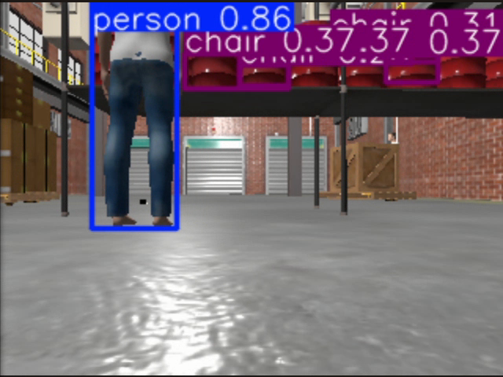
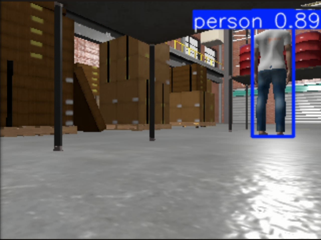
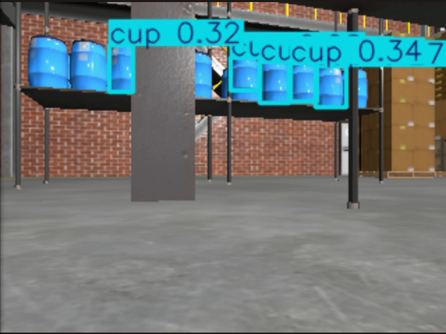
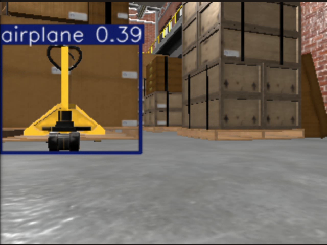
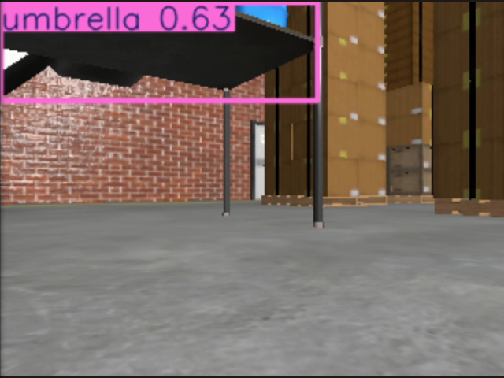
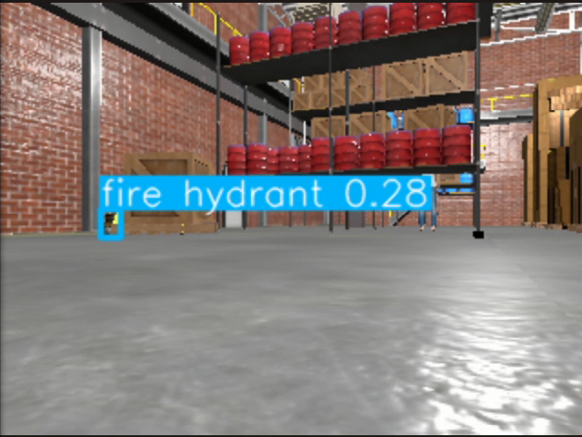
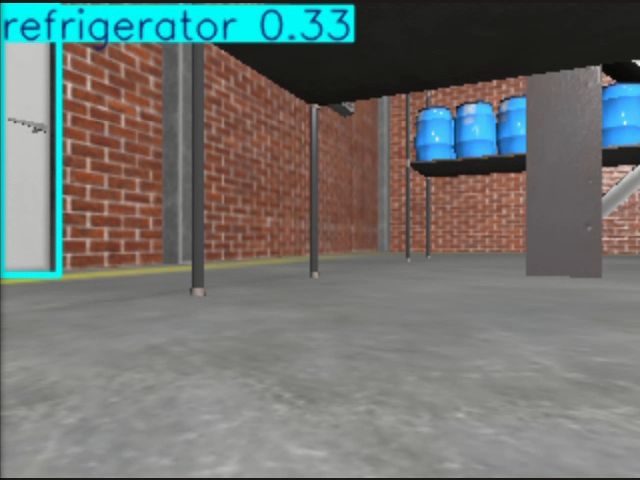
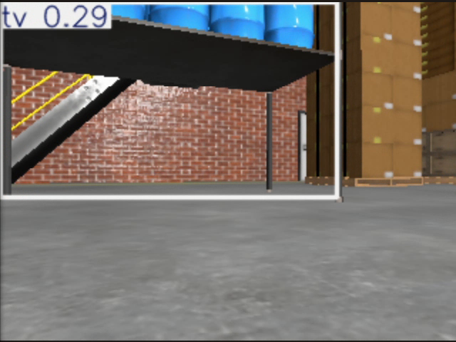
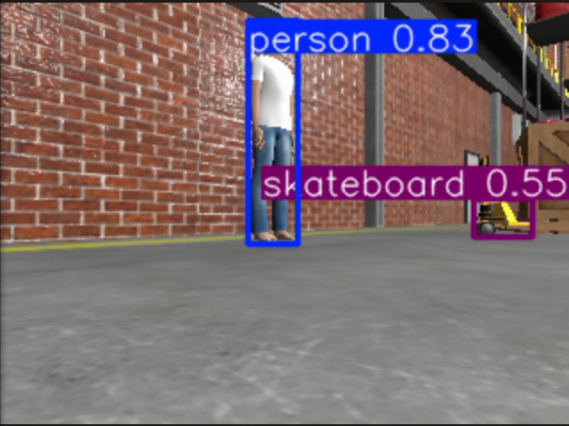

# Phân tích YOLO trong lần chạy tự động qua 6 goal

## Phạm vi và cách đếm

Phân tích từ lúc gửi Goal 1 đến khi Goal 6 thành công: 09:36:12–09:42:19 ngày 18/10/2026 (giờ Việt Nam), khoảng 367.1 giây thực.
Dữ liệu lấy từ yolo.log của lần chạy thật, đối chiếu với video TurtleBot4_6Goals_Nav2_YOLO.webm.
YOLO11n, CPU, confidence threshold 0.25; camera RGB 320×240, giới hạn suy luận 2 khung hình/giây.

Có **160 mẫu kết quả được in ra log**, trong đó **109 mẫu không có detection**, **51 mẫu có detection**, tổng cộng **94 bounding box** thuộc **9 lớp**.
Log được giới hạn khoảng một dòng mỗi 2 giây. Vì vậy, đây là thống kê mẫu log, KHÔNG phải tổng detection của tất cả ảnh trong phiên chạy.
Một vật thể có thể được nhận diện lặp lại ở nhiều mẫu. Một mẫu có thể có nhiều box cùng lớp. Số box không phải số vật thể duy nhất.
Tóm tắt perception_summary.json của TOÀN PHIÊN (cả trước và sau chuỗi goal) ghi 1013 kết quả ảnh nhận được, 418 ảnh có detection và 14 lớp từng xuất hiện. File này không lưu số box theo lớp và không cho phép suy ra số lần từng lớp trong toàn bộ ảnh. Không trộn hai phạm vi dữ liệu này.

## Bảng thống kê và đối chiếu ảnh

| Lớp YOLO | Số box trong log | Số mẫu có lớp | Confidence min–max | Nhận xét ảnh minh chứng |
|---|---:|---:|---|---|
| chair | 36 | 13 | 0.25–0.41 | Sai trong ảnh minh chứng |
| person | 32 | 31 | 0.30–0.90 | Đúng trong ảnh minh chứng |
| cup | 15 | 5 | 0.25–0.39 | Sai trong ảnh minh chứng |
| airplane | 4 | 4 | 0.39–0.39 | Sai trong ảnh minh chứng |
| umbrella | 3 | 3 | 0.27–0.37 | Sai trong ảnh minh chứng |
| fire hydrant | 1 | 1 | 0.28–0.28 | Chưa đủ tin cậy |
| refrigerator | 1 | 1 | 0.33–0.33 | Sai trong ảnh minh chứng |
| tv | 1 | 1 | 0.29–0.29 | Sai trong ảnh minh chứng |
| skateboard | 1 | 1 | 0.55–0.55 | Sai trong ảnh minh chứng |

**Cách hiểu nhận xét:** kết luận đúng/sai áp dụng cho ảnh đã đối chiếu, không gán toàn bộ box của lớp đó là TP hay FP. Chưa có ground truth cho từng box nên không báo cáo precision, recall, mAP hoặc tỷ lệ chính xác.
Các ảnh được trích quanh thời điểm mẫu log trong video. Camera và text JSON là hai topic cập nhật độc lập; ảnh lân cận có thể có confidence khác mẫu log. Confidence trên ảnh không được dùng thay cho số liệu bảng.
Confidence cao vẫn có thể đi cùng nhận diện sai; số lần lặp lại nhiều cũng không chứng minh lớp đó đúng.

## Ảnh minh chứng từng lớp

### chair: Sai trong ảnh minh chứng
Nhãn chair bao quanh các thùng đỏ trên kệ, không phải ghế.
Ảnh trong video tại khoảng 306.61 giây. [Ảnh màn hình gốc](evidence/chair_screen.png).

### person: Đúng trong ảnh minh chứng
Mô hình người có hình dạng, vị trí và bounding box phù hợp. Chưa gán nhãn thủ công toàn bộ các box person.
Ảnh trong video tại khoảng 292.07 giây. [Ảnh màn hình gốc](evidence/person_screen.png).

### cup: Sai trong ảnh minh chứng
Nhãn cup bao quanh thùng chứa màu xanh trên kệ, không phải cốc.
Ảnh trong video tại khoảng 244.37 giây. [Ảnh màn hình gốc](evidence/cup_screen.png).

### airplane: Sai trong ảnh minh chứng
Xe nâng tay màu vàng bị gán nhãn airplane.
Ảnh trong video tại khoảng 50.41 giây. [Ảnh màn hình gốc](evidence/airplane_screen.png).

### umbrella: Sai trong ảnh minh chứng
Bộ phận màu đen phía trên ảnh bị gán nhãn umbrella; không phải ô.
Ảnh trong video tại khoảng 287.66 giây. [Ảnh màn hình gốc](evidence/umbrella_screen.png).

### fire hydrant: Chưa đủ tin cậy
Box rất nhỏ gần chân kệ; ảnh không đủ rõ để xác nhận trụ nước. Chỉ có một mẫu log, confidence 0.28.
Ảnh trong video tại khoảng 157.45 giây. [Ảnh màn hình gốc](evidence/fire_hydrant_screen.png).

### refrigerator: Sai trong ảnh minh chứng
Cột đứng của nhà kho bị gán nhãn refrigerator.
Ảnh trong video tại khoảng 226.51 giây. [Ảnh màn hình gốc](evidence/refrigerator_screen.png).

### tv: Sai trong ảnh minh chứng
Vùng kệ và nền nhà kho bị gán nhãn tv, không có màn hình TV trong box.
Ảnh trong video tại khoảng 268.52 giây. [Ảnh màn hình gốc](evidence/tv_screen.png).

### skateboard: Sai trong ảnh minh chứng
Vật thể màu vàng sát nền (xe nâng tay trong kho) bị gán nhãn skateboard.
Ảnh trong video tại khoảng 388.06 giây. [Ảnh màn hình gốc](evidence/skateboard_screen.png).

## Nhận xét đưa vào báo cáo

Trong môi trường mô phỏng depot, YOLO11n có thể phát hiện mô hình người khi người nằm trong góc nhìn và đủ rõ. Các ảnh đối chiếu đồng thời cho thấy nhiều nhận diện nhầm trên thùng chứa, kệ và cột. Việc gán nhãn lặp lại ở nhiều thời điểm không đồng nghĩa phát hiện thêm nhiều vật thể khác nhau.
Nguyên nhân cần được trình bày như giả thuyết: khác biệt hình ảnh mô phỏng so với dữ liệu huấn luyện, độ phân giải camera nhỏ, vật thể bị che khuất và góc nhìn thay đổi khi robot quay. Lần chạy này chưa có thí nghiệm riêng để định lượng ảnh hưởng từng yếu tố.
YOLO chỉ phục vụ nhận diện/hiển thị; chương trình không dùng nhãn YOLO để quyết định tránh vật cản. Robot lập đường và tránh vật cản bằng Nav2 cùng dữ liệu cảm biến. Navigation 6/6 thành công không phải bằng chứng YOLO phân loại chính xác.
Hướng cải thiện: lưu JSON của mọi kết quả cùng ảnh và timestamp; gán nhãn một tập ảnh đại diện; so sánh ngưỡng confidence trên cùng tập ảnh; cân nhắc tăng độ phân giải hoặc fine-tune bằng ảnh mô phỏng. Với lớp cần cho bài như person, có thể lọc danh sách lớp hiển thị, nhưng việc lọc không tự cải thiện chất lượng nhận diện hay chứng minh các nhãn còn lại đúng.
